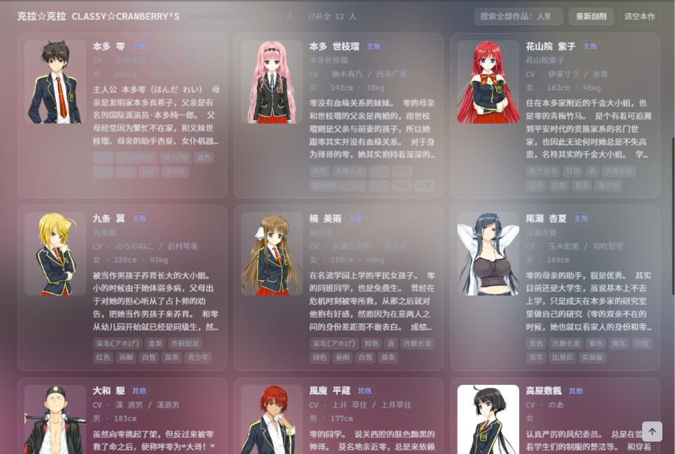
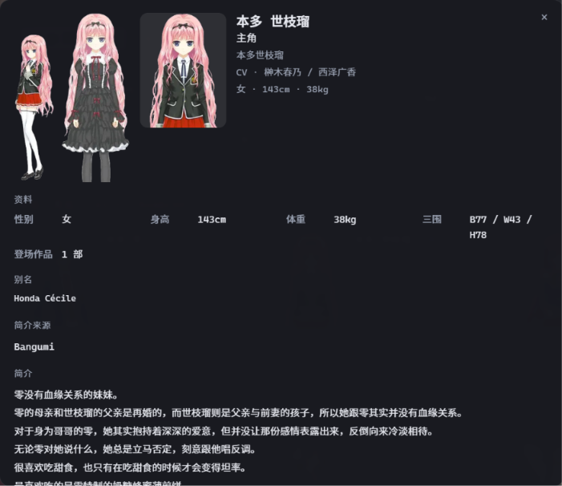
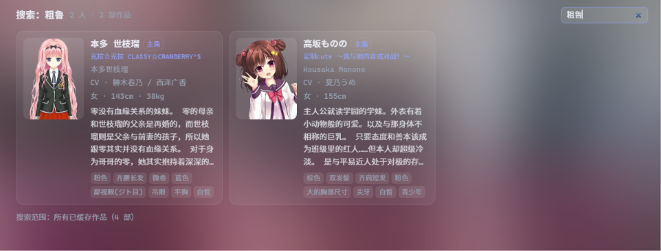
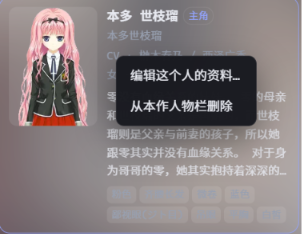
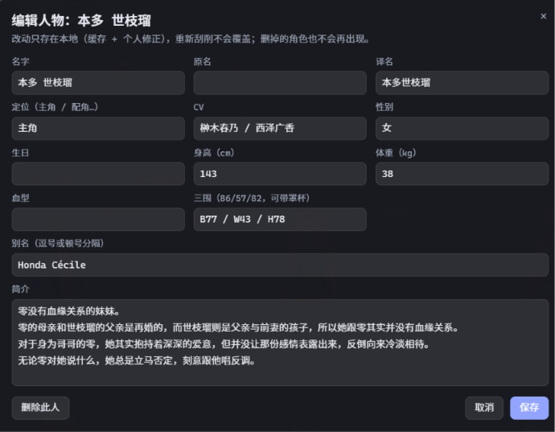
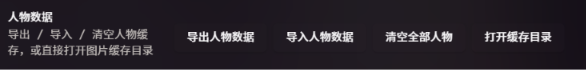

# Character Atlas · 人物图鉴

**给 Vnite 的「游戏详情」加一个原生「人物」标签页 —— 角色卡片墙、全套档案、立绘大图，头像落本地，随时可改可删。**


作者：[@Honda-Cecile](https://github.com/Honda-Cecile) · 插件 id：`character-atlas` · 分类：`common`

---

## 目录

- [为什么做这个](#为什么做这个)
- [功能](#功能)
- [安装](#安装)
- [使用](#使用)
- [设置项](#设置项)
- [备份与迁移](#备份与迁移)
- [数据来源](#数据来源)
- [兼容性](#兼容性)
- [常见问题](#常见问题)
- [开发](#开发)
- [发布到 GitHub](#发布到-github)
- [致谢与许可](#致谢与许可)

> 截图由作者在真实 Vnite 里截取，放在 `docs/screenshots/`，文件名与本文各节的占位一一对应（清单见 [`docs/screenshots/README.md`](docs/screenshots/README.md)）。

---

## 为什么做这个

Vnite 的元数据刮削只到「作品」这一层：封面、简介、开发商、评分、发售日。点进一部 galgame 的详情页，看不到里面有哪些角色、长什么样、声优是谁、性格标签是什么。

这些数据在 VNDB、KunGalgame 上都有，但要开着浏览器一个个查。把整库搬去别的管理器当然能看角色表，可那样就得放弃 Vnite 的界面 —— 我对它的详情页、标签栏、玻璃拟态和字体设置挺满意，不想为了「看一眼人物」换掉整个环境。

所以这个插件做的事很简单：**把「人物」这一层补进 Vnite 自己的详情页里，长得和原生标签页一模一样**。数据来自 KunGalgame 的公开 API（NextMoe Public API v2），KunGalgame 没收录的用 VNDB 兜底，头像与立绘下载到本地。

---

## 功能

### 原生标签页，不是外挂窗口

插件运行在 Vnite 主进程里，没有 UI 挂载 API，所以它自己 `require('electron')` 拿到 `BrowserWindow`，用 `executeJavaScript` 往渲染进程注入脚本：克隆原生 `[role="tab"]` 的类名、把标签栏列数改成等分、把文字换成「人物」，插到「概览」右侧。

结果标签栏变成 **概览 / 人物 / 记录 / 存档 / 回忆**，五个标签同排不换行，下划线动效、字体、字号、字重全部跟随 Vnite 自己的设置。React 重渲染冲掉注入节点时会自动重插（`MutationObserver` + 定时自愈），点原生标签会自动让位。


### 人物卡片墙

- 头像、名字、原名、别名、定位（主角 / 其他）、CV
- 性别 · 生日 · 身高 · 体重 · 血型 · 三围
- 简介摘要（超出省略）
- 特质标签，按「毛发 / 眼睛 / 身体 / 服装 / 性格 / 角色 / 被动(性)…」分组
- 顶部标题带来源徽章 `KunGalgame #886` / `VNDB`，同名系列（同一部作品的多条记录）一眼可辨



### 详情弹窗

点卡片打开：左侧全身立绘 + 头像（都能点开看原图、滚轮缩放），右侧完整资料、全部别名、简介全文、按类别分组的全部特质、来源外链（VNDB / ErogameScape / Bangumi / Getchu…）。

简介会标注来源与是否为机器翻译（如 `Getchu（机器翻译）`），不装作原文。



### 标签取全量，剧透默认收起

KunGalgame 的角色标签本身分三档：`none` / `minor` / `major`。插件以前没带 `spoiler` 参数，拿到的只是服务端默认的那一档（只有 `none`），所以「重度剧透」的标签一直缺着。

现在人物详情的请求固定带 `spoiler=major`，把三档全都刮下来，**每一条都记着自己属于哪一档**。展示上按 Kungal 的规矩来：

- 卡片墙上的小标签：只放无剧透的（刷列表不会被剧透）
- 详情弹窗「特征」区：默认只列无剧透的，右上角一个「显示剧透（N）」按钮，点开才把 `minor` / `major` 的展开（这几条带虚线下划线区分），再点收起
- 同一条标签若同时以 `none` 和 `major` 出现，去重后只留 `none`；`is_lie`（上游标注的「假标签」）照旧丢弃

标签数量因此比以前多出不少 —— 平均每个角色多 1~4 条，主角身上更多。缓存的 `schemaVersion` 升到 2，旧缓存（只有无剧透标签）会被判为过期，第一次打开自动重刮。

### 原名也参与作品匹配

Vnite 里的游戏名常是中文译名，而 KunGalgame 的搜索面只认原语言名与罗马字（`q=古河渚` 是 0 命中，`q=Furukawa` 才有）。以前插件只拿 `metadata.name` 去搜，译名没被收录就报「未收录作品」——明明原名一搜就有。

现在 `metadata.name`（译名）与 `metadata.originalName`（原名）一起进候选，顺序是「译名 → 原名」，逐个查再用标题相似度挑最像的；`|`、`｜`、`/` 连接的拼接标题会先拆开分别试。日志里能看到实际试过哪些写法：

```
作品匹配成功: 天空的作法 → #4242 (search)
```

### 点标签就是跨作品搜索

详情弹窗里点任意特质（比如「双马尾」）或点声优名，直接搜索**所有已缓存作品**里符合的人物，不是只在当前作品里过滤。切到别的作品会自动清空搜索状态。



### 右键：编辑 / 删除

卡片上右键 → 「编辑这个人的资料…」或「从本作人物栏删除」。



编辑弹窗 13 个字段：名字、原名、译名、定位、CV、性别、生日、身高、体重、血型、三围、别名、简介。

改动写进**个人修正层**（PluginDB 的 `charpanel:v1:overrides:<gameId>`），不碰刮削缓存。所以 TTL 到期后的静默刷新、「重新刮削」整份覆盖都不会冲掉你的修改；被删掉的角色即使被重新刮回来也会被过滤。想还原就把修正清掉（「清空全部人物」会连修正一起清）。



### 新增游戏自动刮削

默认开启：游戏被加进库（`game:added`）时后台抓一次人物，不阻塞添加流程，已有缓存就跳过。**老游戏不会被自动触碰**；启动游戏、打开详情页都只读缓存，没数据就显示「开始刮削」。没有定时巡检，后台不会莫名其妙发请求。

### 数据搬家

插件设置页最后一行「人物数据」：**导出人物数据 / 导入人物数据 / 清空全部人物 / 打开缓存目录**。

导出是一份可读的 JSON（`character-atlas-YYYY-MM-DD.json`），包含三层：**刮削数据 + 个人修正 + 已缓存的图片（base64）**。默认「导出时带上图片」是开着的，所以换机器/重装后导入一次，头像立绘立刻离线可用；关掉它则只导出文字，文件小很多。导入会立刻反映到已打开的面板。



> 这四个按钮是插件**启用后注入**的 DOM：插件停用时不存在（Vnite 停用插件后不加载插件代码，manifest 配置里也没有按钮类型控件）。这一行的外观是克隆同容器里的一条原生设置行再换掉文字与右侧控件，所以主题 / 玻璃拟态 / 字号变化时它跟着原生行一起变。

### 其他

- **本地图片缓存**：头像按 `角色名(作品名)__<hash>.jpg` 落盘到 **Vnite 数据目录的 `app/database/character-atlas/images`**（便携版 `<Vnite>/app/database/...`，安装版 `%APPDATA%/vnite/app/database/...`）。放在数据库目录里是有意的：Vnite 的「备份数据库」就是把整个 `app/database` 打 zip，这样头像会跟着官方备份一起走；断网也能显示
- **VNDB 兜底**：KunGalgame 未收录的作品，用游戏自带的 `vndbId` 去 VNDB 取角色表
- **同名重复合并**：NextMoe 里同一角色常有多条记录（多源合并残留），按归一化名字合并，保留信息最全的一条，其余写法并入别名
- **限流自保**：本地滑动窗口（默认 45 次/分）+ 429 `Retry-After` 退避，避免把自己的额度打满

---

## 安装

### 方式一：插件管理里装（推荐）

1. 从 [Releases](../../releases) 下载 `character-atlas-1.1.0.vnpkg`
2. Vnite → 插件 → 安装插件 → 选择这个文件
3. 启用插件，重启 Vnite

### 方式二：手动解压

`.vnpkg` 就是个 zip，解开丢进 Vnite 的插件目录：

- 便携版：`<Vnite 目录>/app/plugins/character-atlas/`
- 安装版：`%APPDATA%/vnite/app/plugins/character-atlas/`

解完目录里应该有 `manifest.json`、`package.json`、`dist/index.js`、`icon.png`、`README.md`。

**要求**：Vnite 4.x（开发与验证环境为 4.15.0）；能访问 `api.nextmoe.dev`。

---

## 使用

1. 打开任意游戏的详情页 → 点「人物」标签
2. 第一次是空的，点 **开始刮削**：先取作品人物表（快），再逐个补全前 N 个人的简介 / 立绘 / 特质（慢，人数在设置里调）
3. 卡片墙出来后：点卡片看详情，点特质 / 声优跨作品搜索
4. 数据不对：右键卡片 **编辑** 改字段，或 **删除** 这个角色
5. 换机器 / 备份：见下一节

数据进 PluginDB 的缓存键 `charpanel:v1:<gameId>`，默认 720 小时后在打开面板时后台静默刷新一次（不阻塞界面）。图片一直在本地，不会重复下载。

---

## 设置项

| 配置 id | 名称 | 默认 | 说明 |
| --- | --- | --- | --- |
| `autoOnLaunch` | 新增游戏时自动刮削 | `true` | 只在游戏被加进库时自动抓一次；老游戏不动 |
| `apiKey` | API Key（可选） | 空 | NextMoe 开发者门户铸造的 `nmk_` 密钥（scope 含 `catalog:read`）。留空即匿名，50 次/分 |
| `baseUrl` | API Base URL | `https://api.nextmoe.dev/v2` | 一般不用改 |
| `lang` | 人物名称语言 | `zh-Hans` | `zh-Hans`（回退日文原名）/ `ja` / `en` |
| `nsfw` | 包含 R18 内容 | `true` | 关掉后请求不带 `nsfw=true`，R18 作品与其中人物不可见 |
| `maxCharacters` | 人物档案深度刮削上限 | `12` | 前 N 个人补全简介/立绘/特质，其余只显示列表信息 |
| `syncToMetadata` | 同步到游戏详情侧栏 | `false` | 把人物摘要写进 `metadata.extra.characters`（会改游戏元数据，默认关） |
| `nativeTab` | 在详情页注入「人物」标签页 | `true` | 关掉就只剩侧栏附加信息与独立面板 |
| `nativeTabLabel` | 标签页文字 | 空 | 留空随界面语言自动切换（人物 / Characters） |
| `cacheTtlHours` | 缓存有效期（小时） | `720` | 过期后打开面板会后台静默刷新一次 |
| `localRateLimit` | 本地限流（次/分） | `45` | 服务端匿名 50 次/分，留点余量避免自我触发 429 |
| `localImages` | 人物头像下载到本地 | `true` | 关掉则直接引用远程图片地址 |
| `exportImages` | 导出时带上图片 | `true` | 「导出人物数据」把已缓存的头像/立绘打成 base64 一起带走；关掉则只导出文字 |
| `vndbFallback` | VNDB 兜底 | `true` | KunGalgame 未收录时改用 VNDB 的角色表 |

---

## 备份与迁移

有三条路，按「想不想让数据人眼可读」选：

### A. 插件自己的导出 / 导入（推荐，跨机器最稳）

设置页 →「导出人物数据」→ 拿到一个 `character-atlas-YYYY-MM-DD.json`（含刮削数据、个人修正、已缓存的头像立绘）→ 新机器装好插件 →「导入人物数据」。

全程不联网，导入后面板立刻可用，图片也不需要重新下载。

### B. Vnite 的「备份数据库」+ 手动解压恢复（官方恢复有 bug）

Vnite 的「备份数据库」会把整个 `app/database` 打成 `vnite-database-YYYYMMDD.zip`（插件数据在 `plugin/`，头像在 `character-atlas/images/`，都在包里）。

**注意：Vnite 自带的「导入数据包 / 恢复数据库」目前有 bug —— 选中备份包后无法正常导入（不生效、或直接报错退出）。** 想用它迁移请手动解压：

1. **先关掉 Vnite**（PouchDB 在跑的时候覆盖 leveldb 会写坏数据）
2. 复制一份现成的 `<Vnite>/app/database` 目录做回滚点
3. 把 `vnite-database-YYYYMMDD.zip` 解压，得到 `config/`、`config-local/`、`game/`、`game-collection/`、`game-local/`、`plugin/`、`theme.v4.css`
   - 如果解压后套了一层同名文件夹，就进到那一层再拷
4. 把这些条目**复制进** `<Vnite>/app/database/`，覆盖同名文件
   - 便携版：`<Vnite 目录>/app/database/`
   - 安装版：`%APPDATA%/vnite/app/database/`
5. 重新启动 Vnite

游戏库、人物数据、个人修正、头像全部就位。想回退就把第 2 步的副本贴回去。

### C. 只搬人物数据（不带走别的插件/GDB）

同样用 A 的 JSON 导出，或者手动只拷 `app/database/plugin/` + `app/database/character-atlas/` 两处。

> `character-atlas/images/` 在数据库目录**里面**，就是为了被官方备份一起带走；它不在 `app/` 根下，别找错地方。

---

## 数据来源

请求只发往两个域：

| 域名 | 用途 |
| --- | --- |
| `https://api.nextmoe.dev/v2` | 主力：作品搜索、作品人物表、人物详情、出场作品 |
| `https://api.vndb.org/kana` | 兜底：KunGalgame 未收录时按 `vndbId` 取角色（可在设置里关） |

**KunGalgame 与 NextMoe 是同一家的两个牌子**：KunGalgame 是站点，NextMoe 是它的开放 API（`developer.nextmoe.dev`，规范在 [KunMoe/kun-galgame-infra](https://github.com/KunMoe/kun-galgame-infra)）。

这个 API 本身是**多源聚合**，不是单一站点自产：

- 人物简介：`intros[].source` 实测有 `vndb`、`erogamescape`、`bangumi`、`getchu`，并带 `is_machine`（机翻标记）—— 面板上的「简介来源 X（机器翻译）」就是直接渲染这两个字段
- 人物外链：`links[]` 指向 `vndb.org/c…`、`erogamescape…character.php?character=…`
- 作品评分：`rating_vndb` / `rating_bangumi` / `rating_erogamescape` / `rating_howlongtobeat` / `rating_nextmoe` 并列
- **特质标签**：NextMoe 自己 wiki 体系的分类（毛发 / 眼睛 / 身体 / 服装 / 性格 / 角色 / 性特质），这部分是鲲自己的数据
- 图片：托管在 KunGalgame 的 CDN（`image.kungal.iloveren.link`），插件下载后转 JPEG 缓存

本插件不抓任何网页 HTML，只读这个 API。

---

## 兼容性

### 换一台新机器能用吗？

能。插件没有原生依赖（`dependencies` 为空），产物是单文件 `dist/index.js`，只要 Vnite 能加载插件就行；第一次运行会自己建目录、自己刮数据。

| 场景 | 第一次打开时会发生什么 |
| --- | --- |
| 全新机器 + 便携版 Vnite | 图片落到 `<Vnite 根>/app/database/character-atlas/images`，目录不存在会自动创建 |
| 全新机器 + 安装版 Vnite | 图片落到 `%APPDATA%/vnite/app/database/character-atlas/images`，同样自动创建 |
| 没有 API Key | 匿名额度够用（服务端 50 次/分、10000 次/日），和填了 Key 的区别只是额度 |
| 没有旧缓存 | 第一次打开某个作品才刮（或点「开始刮削」），老游戏不会被偷偷请求 |
| 断网打开 | 已缓存的照常显示；没缓存的不影响 Vnite 本体，恢复网络后重新刮即可 |
| 从旧版本升上来 | 会把旧位置的图片复制到新目录，不用重新下载 |

### 便携版与否，插件怎么判断？

判定规则对齐 Vnite 自己（`getDataPath()`：便携 = `<exe 同目录>/app/database`，否则 `<userData>/app/database`），三条判据按顺序命中第一条：

1. `<exe 同目录>/app/database/plugin` 存在 → 便携（Vnite 每次启动都会建 `plugin` 库，最可靠）
2. `<exe 同目录>/app/database` 存在 → 便携
3. `<exe 同目录>/app` 存在 → 便携（刚解压、数据库还没建出来的情况）
4. 都不成立 → 安装版，用 `%APPDATA%/vnite/app/database`

**没开便携功能（即安装版）完全不影响使用**，只是数据目录换成 `%APPDATA%\vnite\app\database`；两种模式下图片都在**数据库目录里**，所以 Vnite 的「备份数据库」都会把它带走。

启动时插件会在 `%TEMP%\character-atlas\debug.log` 写一行实际判定结果，排查「头像存哪去了」直接看这行：

```
[character-atlas] 图片缓存目录: ...\app\database\character-atlas\images（安装版（userData））
```

### 其他

- **Windows**：便携版 / 安装版都支持，代码里没有硬编码路径（全部走 `app.getPath`）
- **网络**：主进程 `fetch` 直连，走系统 DNS。需要代理的机器请用 TUN / 全局代理（Node 的 `fetch` 不读 `HTTP_PROXY`）
- **Vnite 版本**：`manifest.vniteVersion` 为 `^4.0.0-beta.2`，实测 4.15.0。标签页注入依赖详情页的 `[role="tablist"]`、「基本信息」里的 原名/译名、以及 `#/library/games/<gameId>/<groupId>` 路由；Vnite 大改版可能导致标签插不上，此时设置页的「人物数据」工具条与手动刮削仍然可用
- **多显示器 / 缩放**：注入脚本用视口坐标定位弹窗与菜单，会自动夹在可视区域内
- **与其他插件共存**：不修改 `kungal-catalog`（`vnite-plugin-kungal`）的任何数据与配置，两者可同时安装

---

## 常见问题

**人物栏没出现？**
详情页必须有标签栏（Radix tabs）。确认设置里「在详情页注入『人物』标签页」是开的；改完设置需要重启 Vnite（插件在启动时注入）。

**标签栏挤成两排？**
插件会把 `tablist` 的列数改成 `repeat(N, minmax(0,1fr))` 并把标签设为 `flex:1 1 0;min-width:0`。如果还是换行，说明 Vnite 改了标签栏结构，欢迎提 issue 附 HTML 片段。

**设置页最下面那四个按钮去哪儿了？**
它是插件激活后注入的 DOM，**插件停用时不存在**（Vnite 停用插件后不加载插件代码，manifest 配置里也没有按钮类型的控件）。启用插件、重开设置对话框就会出现。

**提示「没能匹配到该游戏」？**
插件用 `vndbId` → 相关网站（vndb / dlsite 链接）→ 名字搜索 的顺序定位作品；名字搜索会同时试「译名」和「原名」。如果这部作品在 Vnite 里只有很偏的名字（比如只有 2dfan 译名、英文名），两个名字都搜不到就会 0 命中。两个办法：把「原名」补成 KunGalgame 的作品名（日文原名最准）；或打开「VNDB 兜底」。

**标签比 Kungal 网页上少？**
默认只显示「无剧透」标签。详情弹窗右上角点「显示剧透（N）」就会把轻微/重度剧透的那部分一起展开（虚线下划线的几条）。卡片墙上的小标签我故意只取无剧透的，避免刷列表就被剧透。

**同一个人出现两次 / 两部作品显示同一份名单？**
同一角色在数据源里常有多条记录，插件按归一化名字合并，并在标题旁显示 `KunGalgame #<workId>` 徽章。如果同一系列的两部作品本来就共用角色，名单相似是数据事实，看徽章就能确认当前挂的是哪一部。

**429 / 拉取很慢？**
匿名额度 50 次/分。把「本地限流」调到 30–40，或去 [developer.nextmoe.dev](https://developer.nextmoe.dev) 领一个 `nmk_` 密钥填进设置，额度更高。

**报「鉴权失败 (401)」，清空了 API Key 还是 401？**
两个原因叠在一起，1.0.0 里都修掉了：

- 无效的 Key 会让每个请求都白撞一次 401。现在插件遇到 401 会**立刻丢掉 Authorization 用匿名重试**，并在本次运行内保持匿名，刮削不会因此失败，只会在 `debug.log` 里留一行提示。
- Vnite 的设置对话框保存时**只写数据库、不会重载插件**，而旧版插件只在激活时读一次配置 —— 所以清空 Key 之后内存里仍然糊着旧 Key。现在每次刮削前都会重读一遍配置（只采纳数据库里真正变化的字段），改完设置直接生效，不用重启。

装的是旧版的话，清空 Key 后把插件**关掉再打开**（或重启 Vnite）同样能立刻恢复。另外确认「基础 URL」是 `https://api.nextmoe.dev/v2`（带 `/v2`）。

**图片不显示？**
确认「人物头像下载到本地」状态与网络可达 `image.kungal.iloveren.link`。图片缓存在 `app/database/character-atlas/images`，设置页「打开缓存目录」可以直接跳过去。

**我改的资料又被刮掉了？**
不会。编辑/删除写的是个人修正层，独立于缓存。只有「清空全部人物」才会连修正一起清。

**Vnite 的「备份数据库」里包含这个插件的数据吗？图片呢？**
都包含。备份会把整个 `app/database` 打成 zip：插件库 `plugin/` 里有缓存、个人修正、作品解析结果，`character-atlas/images/` 里有头像立绘。恢复备份后不需要重新下载。代价是备份包变大（几百张 168px 缩略图约几十 MB）。

**「导入数据包」点了没反应 / 报错？**
这是 Vnite 自带恢复功能的已知问题，与本插件无关。请按上面「[备份与迁移](#备份与迁移)」里的 **B. 手动解压恢复** 操作。

**卸载插件后残留什么？**
PluginDB 里的 `charpanel:v1:*` 与 `charpanel:v1:overrides:*`，以及数据库目录下的 `character-atlas/images` 图片目录（设置页「打开缓存目录」可以直接跳过去）。删掉这两处就干净了。

---

## 开发

```bash
npm install
npm run build        # webpack → dist/index.js（单文件，node target）
npm run pack         # → dist/character-atlas-1.1.0.vnpkg
npm run build:watch  # 边改边构建
npm run typecheck    # tsc --noEmit
```

探针（都不需要开 Vnite）：

| 脚本 | 覆盖内容 |
| --- | --- |
| `node scripts/smoke.js` | 真实 API 冒烟：激活、IPC、刮削、缓存、导出/导入（含图片层）、停用 |
| `node scripts/probe-native.js` | 注入逻辑：标签顺序、单排、匹配、面板可见、立绘弹窗、路由身份、去重 |
| `node scripts/probe-ui.js` | UI 行为：搜索、筛选、设置项、单高亮、残留面板、切作品清搜索 |
| `node scripts/probe-edit.js` | 右键菜单 → 编辑 → 删除 → 重新下发 |
| `node scripts/probe-overrides.js` | 修正层与自动刮削开关（离线，mock DB） |
| `node scripts/probe-dedupe.js` | 同名重复合并（真实 API） |
| `node scripts/probe-real-panel.js` | 真实数据 + Chrome 无头截图 |
| `node scripts/verify-package.js` | 校验 `.vnpkg`：文件、14 项配置的 `controlType`、导出符号 |
| `node scripts/probe-traits.js` | 标签档位：`spoiler=major`、去重取最低档、`is_lie` 丢弃、原名参与匹配（离线） |
| `node scripts/probe-spoiler.js` | 剧透折叠的 DOM 行为：卡片不含剧透标签、弹窗默认收起、展开/收起（离线） |
| `node scripts/probe-auth.js` | API Key 失效时降级匿名访问、配置热重读（离线） |
| `node scripts/probe-paths.js` | 图片缓存目录判定：便携 / 安装版 / 无 Electron 三种情形（离线） |
| `node scripts/preview-settings.js` | 离线渲染设置页 mock（`.tmp/native/preview-settings.png`），核对注入行的外观 |
| `node scripts/preview-scrollbars.js` | 离线核对面板 / 弹窗 / 文本框都没有可见滚动条 |
| `node scripts/stage-release.js` | 把一个版本归档进 `releases/<版本号>/`（见下节） |
| `node scripts/backup-source.js` | 给每个版本补一份源码快照 `source-v<版本>.zip`（`git archive` 出来的 tag 树） |
| `node scripts/publish.js` | 一条链路发布：需要时先推 tag → 建 Release → 传包 → 回读确认（`--dry-run` 演练） |
| `node scripts/probe-conflict.js` | PluginDB 并发读写的 409 冲突重试（离线） |
| `node scripts/probe-double-activate.js` | `activate()` 重复调用的幂等性，不重复注册 IPC（离线） |
| `node scripts/check-releases.js` | 发布前审计：目录名 / 包内版本 / tag / sha256 / 源码快照是否一一对上 |

## 致谢与许可

- 数据来自 [KunMoe](https://github.com/KunMoe/kun-galgame-infra) 的 NextMoe Public API v2，请遵守其[使用条款与限流](https://developer.nextmoe.dev)
- 请求层契约（限流窗口、`Problem` 错误信封、`localized` / `intros` 取值优先级）参考自刮削器插件 `kungal-catalog` 0.1.0 (https://github.com/binvv0/vnite-plugin-kungal)
- 插件 SDK：[`vnite-plugin-sdk`](https://github.com/ximu3/vnite-plugin-sdk)（作者 ximu3）
- VNDB 兜底使用 [VNDB Kana API](https://api.vndb.org/kana)
- 插件作者：[@Honda-Cecile](https://github.com/Honda-Cecile)

本项目以 **GPL-3.0-only** 发布，见 [`LICENSE`](LICENSE)。
